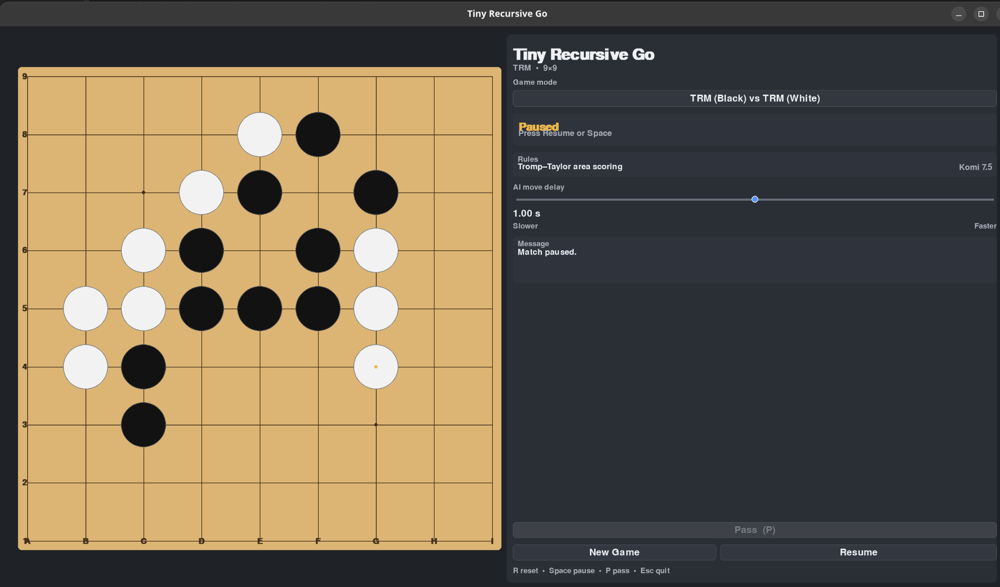
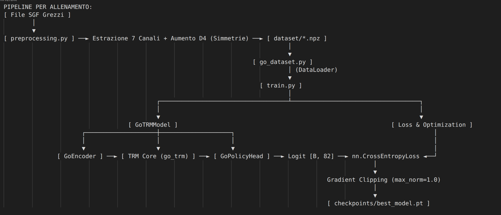
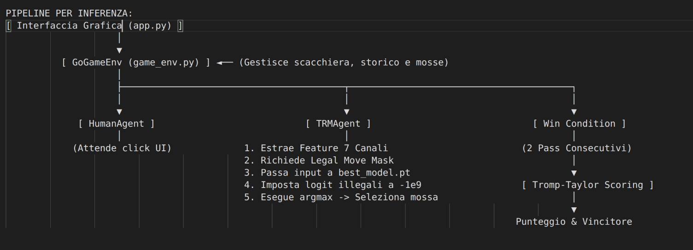

# Goal
The goal is to test if Tiny Recursive Model (TRM) is suitable for solving deterministic problems like playing Go, changing only what is necessary and keeping intact the core recursive architecture.

The Go training pipeline supports square boards of configurable size. The existing dataset and checkpoint are for 9x9; the code can also process and train on 19x19 once a matching dataset is available.

# Setup
In order to replicate the project on your machine you need to install all the necessary libraries and you can do that in two ways:

1. If you use pip:
```bash
pip install -r requirements.txt
```
2. If you use uv:
```bash
uv sync
```

# How to use:
If you want to **play the game**, the repository already contains a trained 9x9 model. After installing the libraries, run the app from the `TRM/` directory. The default is 9x9 and uses `checkpoints/best_model.pt`:
```bash
cd TRM/
python3 app.py --board-size 9
```

To play 19x19, select that board size; the app will load the matching checkpoint from `checkpoints/19x19_go/best_model.pt`:
```bash
python3 app.py --board-size 19
```

The mode selector in the GUI continues to cycle through all three existing modes: Human (Black) vs TRM (White), TRM (Black) vs Human (White), and TRM vs TRM. The selected board size applies to the whole game and is validated against the loaded checkpoint. You can also load a checkpoint directly with `--checkpoint`; if `--board-size` is also provided, the two sizes must match.

When the TRM selects a move, it randomizes uniformly only among legal actions whose predicted probability is within 2 percentage points of the best legal action. If no other action is that close, it selects the best action. This adds variety without sampling broadly from lower-probability moves; it also applies to greedy self-play in `go_pass_eval.py`.

The 19x19 launch command requires a trained 19x19 checkpoint. The repository currently contains only the 9x9 model, so first prepare the 19x19 dataset and train it as described below.

If you want to **prepare a dataset**, place SGF files under the matching raw-games directory and run preprocessing with the board size. By default, preprocessing reads 9x9 games from `9x9_go/go_raw_dataset/9x9_games/` and writes the train, validation, and test datasets to `9x9_go/go_dataset/`.
```bash
cd TRM/
python3 go_preprocessing.py --board-size 9
```

To prepare a 19x19 dataset, place the 19x19 SGF files under `19x19_go/go_raw_dataset/19x19_games/` and run:
```bash
python3 go_preprocessing.py --board-size 19
```

The preprocessing script reconstructs missing terminal PASS moves only for fully processed games with an explicitly scored result. It does not add PASS moves to games ending by resignation, time loss, or forfeiture.

To **filter SGF files by board size** from an archive directory, use the extraction helper. The source path is relative to the current working directory:
```bash
cd TRM/
python3 9x9_go/go_raw_dataset/extract_9x9.py --board-size 9 --source ./games
python3 9x9_go/go_raw_dataset/extract_9x9.py --board-size 19 --source ./games
```

If you want to **train the model from scratch**, pass the same board size used to prepare the dataset. The 9x9 checkpoint is saved to `checkpoints/best_model.pt`; models for other sizes are saved in a size-specific subdirectory such as `checkpoints/19x19_go/best_model.pt`.
```bash
cd TRM/
python3 train.py --board-size 9
```

For 19x19, when its dataset is available:
```bash
python3 train.py --board-size 19
```

The policy head produces `N*N + 1` logits: one for each board intersection and one for PASS. The PASS action index is `N*N` (81 on 9x9 and 361 on 19x19). The board size is stored in each new checkpoint and is used automatically by inference and the GUI.

Training saves `best_model.pt` whenever validation loss improves during that training run. The training output's `Train Top-1` is measured on the training split, while `Val Top-1` and the checkpoint's `val_top1` are measured on the validation split. `go_eval.py` reports accuracy on the separate test split, so its Top-1 can legitimately differ from the checkpoint's validation Top-1. The training and validation metrics are aggregated per example, including a smaller final batch.

To **evaluate a trained model** on its corresponding test dataset:
```bash
python3 go_eval.py --checkpoint checkpoints/best_model.pt
```

For another board size, pass its size-specific checkpoint:
```bash
python3 go_eval.py --checkpoint checkpoints/19x19_go/best_model.pt
```

Evaluation metrics, predictions, and plots are saved under `evaluation_results/` (with a board-size-specific subdirectory for non-default board sizes). To run the optional single-batch overfit check:
```bash
python3 micro_train.py --board-size 9
```

# Dataset
The dataset source is: https://homepages.cwi.nl/~aeb/go/games/

The repository currently includes the processed 9x9 dataset. The `19x19_go/` directory is reserved for 19x19 SGF files and generated datasets; those data files are not included yet.

# Changes Made:
Below you can find the list of all the changes made to the original TRM:
## Added Repository
```bash
TRM/9x9_go
```
This folder contains the raw SGF games used for the 9x9 dataset and the processed train, validation, and test splits. The extraction helper filters games by board size, and `go_preprocessing.py` converts them into NumPy arrays.

```bash
TRM/19x19_go
```
This folder reserves locations for 19x19 raw games and processed datasets. The dataset files will be generated there when a 19x19 SGF collection is available.

## Added Files
### TRM

```bash
TRM/go_preprocessing.py
```
This module reads SGF games of the requested board size and creates train, validation, and test datasets in `.npz` format. Each input `X` has shape `[SIZE, CHANNELS, N, N]`, where `SIZE` is the number of examples, `CHANNELS` is 7, and `N` is the board size. Each target `y` has shape `[SIZE]` and contains a board action or PASS (`N*N`).

The data is split by game, so moves from a single SGF are not distributed across different splits. For fully processed games with an explicitly scored result, missing consecutive terminal passes are reconstructed to provide terminal examples.

```bash
TRM/go_dataset.py
```
This file loads the `.npz` splits into PyTorch datasets and dataloaders, validates the board and action dimensions, and optionally applies random rotations and reflections for data augmentation.

```bash
TRM/micro_train.py
```
This script runs a short single-batch overfit check to verify that the model and training path are connected. It loads a matching dataset when present and otherwise uses synthetic data.

```bash
TRM/train.py
```
This file configures and runs supervised training. Its `--board-size` parameter determines the expected dataset directory, model sequence length, action count, and checkpoint location.

```bash
TRM/game_env.py
```
This file implements the Go environment and handles:
- Storing the board state and the history of the last 3 turns (required by the `GoEncoder`).
- Checking legal moves and generating the Legal Move Mask.
- Managing turn transitions and PASS moves.
- Calculating the final score using Tromp-Taylor/area scoring.

The board size is configurable. PASS is always legal during an active game, and two consecutive passes end the game.

```bash
TRM/agents.py
```
This file implements `HumanAgent` and `TRMAgent`. The TRM agent loads the board size from its checkpoint, converts the environment state into model features, masks illegal moves, and randomizes only among legal moves within 2 percentage points of the top probability. It rejects environments whose board size does not match the checkpoint.

```bash
TRM/go_eval.py
```
This file evaluates supervised next-move prediction on the test dataset associated with the checkpoint. Its Top-1 metric is for the test split and is not expected to match the checkpoint's validation Top-1 exactly. It saves metrics, predictions, and diagnostic plots under `evaluation_results/`.

```bash
TRM/go_pass_eval.py
```
This file runs self-play to check whether the model naturally ends games by choosing two consecutive PASS moves. Results are saved under `pass_eval_results/`.

```bash
TRM/app.py
```
This file provides the Pygame GUI. It supports Human vs TRM (either color) and TRM vs TRM modes, a configurable move delay, and pausing an AI-vs-AI game. The board and labels use the size stored in the selected checkpoint.


### TRM/models
```bash
TRM/models/go_encoder.py
```
This file encodes a board tensor `[Batch, Channels, N, N]` into one token per intersection `[Batch, N*N, Hidden_size]`. A padded convolution preserves the board dimensions while extracting local features, and learnable positional embeddings provide each token with its board location.

```bash
TRM/models/go_policy_head.py
```
This file maps the TRM output tokens to policy logits. It produces `N*N` logits for board moves and one additional logit for PASS, for a total of `N*N + 1`.

## Modified files
```bash
TRM/models/go_trm.py
```
This module adapts the TRM core to Go. The configured board size determines the sequence length (`N*N`) used by the encoder and reasoning model. Checkpoints created before board-size configuration are interpreted as 9x9.

# Testing
`test_game_env.py` checks the board rules and legal-move behavior. `test_go_board_size.py` checks model output dimensions and board symmetries for both 9x9 and 19x19. `go_pass_eval.py` is a self-play diagnostic for natural game termination.

Run the unit tests from the repository root with:
```bash
python3 -m pytest TRM/test_game_env.py TRM/test_go_board_size.py
```

# Pipeline
PIPELINE FOR TRAINING PHASE:


PIPELINE FOR INFERENCE PHASE:

